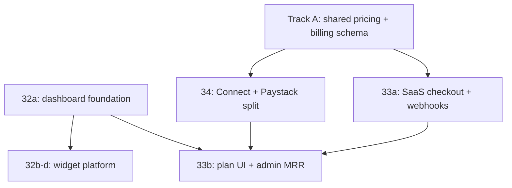

# Implementation playbook — dashboard, SaaS billing, settlement

> **How to begin** turning pricing/strategy conversations into shipped code.  
> **Authority:** [pricing-and-monetization.md](./pricing-and-monetization.md) · specs **32 / 33 / 34**.

---

## 1. What we are building (four tracks)

| Track | Sprint | Outcome |
|-------|--------|---------|
| **A. Commercial foundation** | Pre-32/33 | Country pricing in `@adeni/shared`; tenant billing model; deprecate perpetual `free` |
| **B. Portal dashboard** | [32](./specs/sprint-32-portal-dashboard-revisit.md) | Widgets, charts, customize; plan widget |
| **C. SaaS billing (MRR)** | [33](./specs/sprint-33-saas-subscription-billing-mrr.md) | Trials, discounts, checkout, `/plan`, admin promos + MRR v1 |
| **D. GMV settlement** | [34](./specs/sprint-34-payment-settlement.md) | Connect + Paystack split; business-paid fee from config |

Tracks **B (32a)** and **A** can start **immediately**. **C** needs **A** (billing fields + pricing catalog). **D** can overlap **C**; NA GMV % stays **effective 0** until Connect ships.

---

## 2. Dependency graph

---

## 3. Recommended order (PRs)

### Step 0 — Lock product (you, ~30 min)

- [ ] Mark [pricing-and-monetization.md](./pricing-and-monetization.md) **Approved** in repo (or Confluence) — NG **50/70/100**, US **150/200/250**, CA **200/250/300**, GMV **0% NG / 0.75% NA target**, **business-paid**, trials on **Professional** default **90d** (if not changed).
- [ ] Confirm trial default SKU + `blockPaymentsUntilOnboarding` for NG (grace **false** in JSON today).

### Step 1 — Track A, PR 1: `country-pricing` in shared (1–2 days)

**No DB migration yet.**

| Task | Where |
|------|--------|
| Zod schema for `country-pricing.json` | `packages/shared/src/schemas` or `country-pricing.ts` |
| Export `getCountryPricing(countryCode)`, `getGmvCollection(countryCode)` | `packages/shared` |
| Map `SubscriptionTier` → SKU ids `starter \| professional \| business` (aliases for legacy `free/pro/business` during migration) | `packages/shared` |
| Unit tests for NG/CA/US amounts | `packages/shared` tests |

**Done when:** portal/API can read list prices and `gmvCollection` without hard-coded PLAN_PRICING strings (keep PLAN_PRICING generated from catalog or deprecated).

### Step 2 — Track B, PR 2: Sprint **32a** dashboard (2–4 days)

Spec: [sprint-32-portal-dashboard-revisit.md](./specs/sprint-32-portal-dashboard-revisit.md) phase 32a only.

| Task | Where |
|------|--------|
| Fix revenue KPI (ledger **Collected** or honest label) | `apps/portal/.../dashboard` |
| Plan strip + link `/plan` + near-limit | dashboard + `@adeni/shared` |
| Gated shortcuts (messages, staff, etc.) | dashboard template |
| Optional: show country + trial placeholder copy | dashboard |

**Done when:** smoke checklist 32a in spec passes.

### Step 3 — Track A, PR 3: Tenant billing schema + domain (3–5 days)

| Task | Where |
|------|--------|
| Migration: `subscription_sku`, `billing_status`, `trial_ends_at`, `paid_through`, discount fields, `country_code` on billing snapshot | `db/Adeni.Database` + EF |
| Replace or map `SubscriptionTier.Free` → Starter + trialing | Domain + `SubscriptionEntitlements` |
| Admin: trial days, discount % / fixed, comp reason | `AdminBusinessService` + admin UI stub |
| `IEntitlementsService` uses SKU + `billing_status` (trialing = trial SKU entitlements) | Infrastructure |

**Done when:** admin can set trial end; API profile returns billing block; existing tests updated.

### Step 4 — Track C, PR 4–5: Sprint **33a** SaaS billing (1–2 weeks)

Spec: [sprint-33-saas-subscription-billing-mrr.md](./specs/sprint-33-saas-subscription-billing-mrr.md).

| PR | Task |
|----|------|
| 4 | Paystack Subscriptions + Stripe Billing providers; Murphy webhooks; tier/SKU sync |
| 5 | `POST checkout`, `GET tenant/billing`, portal `/plan` upgrade + trial banner; `@adeni/api-client` |

Use **country-pricing** for checkout line items. Wire **admin** commercial controls from Step 3.

### Step 5 — Track B, PR 6–8: Sprint **32b–32c** dashboard platform (parallel with 33b)

| PR | Task |
|----|------|
| 6 | `ITenantDashboardService` + aggregate APIs |
| 7 | Widget grid + Carbon charts + default layout |
| 8 | Layout persistence `GET/PUT /tenant/dashboard/layout` |

Gate analytics widgets by **Professional+** SKU / entitlements.

### Step 6 — Track C, PR 9: Sprint **33b**

Admin MRR v1, tenant billing history on `/plan`, email trial ending (or log-only v1).

### Step 7 — Track D, PR 10–12: Sprint **34** settlement

Spec: [sprint-34-payment-settlement.md](./specs/sprint-34-payment-settlement.md).

| PR | Task |
|----|------|
| 10 | Connect onboarding + tenant fields + Stripe destination + `application_fee` |
| 11 | Paystack subaccount + split at 0% (100% subaccount) |
| 12 | Ledger gross/fee/net columns; enable effective NA 0.75% when Connect verified |

---

## 4. What to do **this week** (concrete)

If starting **today**:

1. **Step 0** — approve pricing doc mentally; no code.
2. **Step 1** — implement shared `country-pricing` loader + tests (**first PR**).
3. **Step 2** — **32a** dashboard in same branch or PR right after.
4. Write **migration design** for Step 3 (columns list in sprint-33 spec appendix) — review before merging PR 3.

Do **not** start Connect/Paystack split until Step 3 billing schema exists (shared tenant country resolution).

---

## 5. Team split (if 2 devs)

| Dev | Focus |
|-----|--------|
| **A** | Track A + 33a/33b (API, webhooks, admin billing) |
| **B** | 32a → 32b–c (portal dashboard) → 34 portal onboarding UX |

Sync on `packages/shared` contracts before parallel API/portal work.

---

## 6. Testing bar (each track)

| Track | Run |
|-------|-----|
| API | `dotnet test Adeni.slnx -c Release` |
| Portal | `npm run dev` portal + smoke routes |
| Security | Webhook signature tests; cross-tenant checkout denial; business-paid: assert initialize amount === business price when fee &gt; 0 |

---

## 7. Docs to update as you ship

| When | Doc |
|------|-----|
| PR 1 | `subscription-tiers.ts` / PLAN_PRICING sourced from catalog |
| PR 3 | [pricing-and-monetization.md §8 migration](./pricing-and-monetization.md#8-migration-from-current-free-tier) status |
| PR 4 | [subscription-billing.md](./subscription-billing.md) stub → live |
| PR 12 | [payments.md](./payments.md) collection gap closed |
| End 32 | [sprints.md](./sprints.md) task checkboxes |

---

## 8. Out of scope for this playbook

- Sprint 20 deploy/observability (parallel infra)
- POS bridge, AI agents
- Guest surcharge (policy: no)

---

## Quick links

| Doc | Purpose |
|-----|---------|
| [sprint-32-portal-dashboard-revisit.md](./specs/sprint-32-portal-dashboard-revisit.md) | Dashboard |
| [sprint-33-saas-subscription-billing-mrr.md](./specs/sprint-33-saas-subscription-billing-mrr.md) | MRR |
| [sprint-34-payment-settlement.md](./specs/sprint-34-payment-settlement.md) | Connect/split |
| [payment-provider-settlement.md](./payment-provider-settlement.md) | Settlement design |
| [country-pricing.json](../packages/shared/src/data/country-pricing.json) | Config source |
