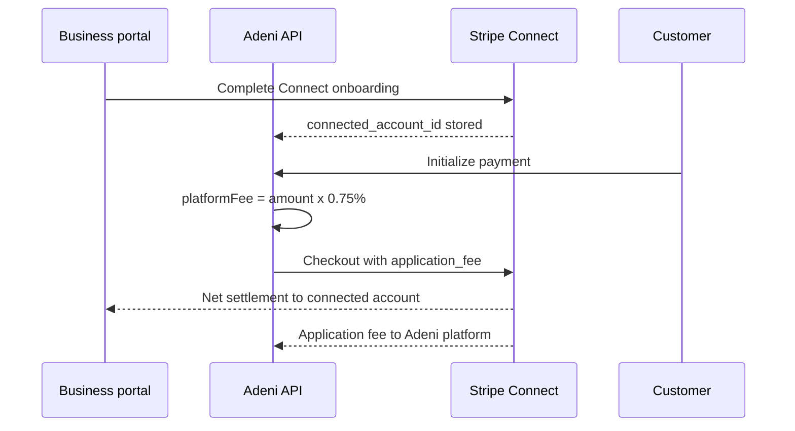

# Pricing & monetization (v2 direction)

> **Status:** Draft strategy (Oct 2026) — supersedes perpetual **Free tier** language in [product-strategy.md §4.1](./product-strategy.md#41-saas-subscriptions--foundation-mrrarr) when approved.  
> **Authority chain:** [product-direction.md](./product-direction.md) → this doc → [subscription-billing.md](./subscription-billing.md) (SaaS) + [payments.md](./payments.md) (GMV).

---

## 1. Principles

1. **Adeni is a paid product.** No permanent free plan — use **trials** and **admin discounts** ([§5](#5-trials-grace-and-discounts-not-tiers)).
2. **SKU ladder:** Starter → Professional → Business ([§3](#3-product-skus)).
3. **Prices vary by country, not city.** Lagos = Abuja = Port Harcourt (**NG**). Ottawa = Toronto = Vancouver (**CA**). Houston = Dallas (**US**). GTM **markets** (`lagos`, `ottawa`) are discovery/geo; **billing** resolves `countryCode` on the tenant’s primary location.
4. **Hybrid revenue (Zenoti-shaped):** SaaS MRR + **platform % on GMV** + optional add-ons; **non-custodial** payments.
5. **GMV platform fee is business-paid.** The customer pays **only** the amount the business set (service, deposit, or pay link). Adeni’s platform % is deducted from **business settlement**, not added to the customer checkout total ([§6.4](#64-gmv-platform-fee-business-paid-policy)).
6. **Published list prices** on `/plan` (self-serve), unlike Zenoti quote-only.

**Catalog (draft):** [packages/shared/src/data/country-pricing.json](../packages/shared/src/data/country-pricing.json) — SaaS `skus` + `gmvCollection` (Connect / Paystack split). Settlement detail: [payment-provider-settlement.md](./payment-provider-settlement.md).

---

## 2. Country list prices (stakeholder anchors)

| Country | Currency | Starter | Professional | Business | GMV platform fee |
|---------|----------|---------|--------------|----------|------------------|
| **NG** (Africa) | NGN | **₦50,000** | **₦70,000** | **₦100,000** | **0%** (pilot / supply growth) |
| **CA** | CAD | **$200** | **$250** | **$300** | **0.75%** (draft — enable with Connect collection) |
| **US** | USD | **$150** | **$200** | **$250** | **0.75%** (draft — enable with Connect collection) |

**Tier step rule:** **+$50** per step for **US and CA**. **NG:** **+₦20k** per step (**₦50k → ₦70k → ₦100k**).

**Implementation:** resolve price with `tenant.primaryLocation.countryCode` → `country-pricing.json`. Do **not** duplicate prices per `market_id`.

---

## 3. Product SKUs

| SKU | Entitlements (summary) |
|-----|-------------------------|
| **Starter** | Calendar, bookings, public profile, basic dashboard, WhatsApp bridge |
| **Professional** | Starter + inbox, reminders, **analytics dashboard** |
| **Business** | Pro + multi-location, staff, priority support, advanced ops widgets |

Same SKU names and feature bundle **worldwide**; only **amount and currency** change by country.

Legacy code enum `free | pro | business` maps to **Starter | Professional | Business** at migration ([§8](#8-migration-from-current-free-tier)).

---

## 4. Revenue streams

| # | Stream | Description |
|---|--------|-------------|
| 1 | **SaaS MRR** | Monthly subscription per SKU × country list price (minus discounts) |
| 2 | **Platform GMV fee** | Adeni’s **% of customer payment volume** through Adeni checkout ([§6](#6-customer-payments-pass-through-vs-platform-gmv-fee)) |
| 3 | **Provider rev-share** | Optional commercial agreement with Paystack/Stripe (separate from GMV fee) |
| 4 | **Add-ons** | SMS packs, AI agent, Insights (later) |

---

## 5. Trials, grace, and discounts (not tiers)

### 5.1 Trial (default onboarding)

- Admin **country default**: e.g. 90 days on **Professional** for new verified businesses in **NG**.
- Fields: `subscriptionSku`, `billingStatus: trialing`, `trialEndsAt`.
- End of trial: charge or **suspend** (no silent free tier).

### 5.2 Admin commercial controls

Trial length, extend, **% or fixed discount** for N cycles, comp with audit — per tenant or country default. See [sprint-33 spec](./specs/sprint-33-saas-subscription-billing-mrr.md).

---

## 6. Customer payments: pass-through vs platform GMV fee

This is **customer → business** money (deposits, pay links, balance checkout). Separate from **business → Adeni** SaaS ([subscription-billing.md](./subscription-billing.md)).

### 6.1 Three layers on one checkout

Example: client pays **₦10,000** for a haircut via Adeni.

| Layer | Who sets it | Who pays it | Where it goes today |
|-------|-------------|-------------|---------------------|
| **A. Service amount** | Business | Customer | Intended for **business** (minus B and C) |
| **B. Provider processing** | Paystack / Stripe | Usually **business** (deducted from settlement) | **Licensed provider** — interchange + acquirer (pass-through) |
| **C. Adeni platform fee** | Adeni (`platformFeePercent` by country) | Policy choice ([§6.4](#64-who-pays-the-platform-fee)) | **Adeni** — must be **collected**, not only calculated |

**Pass-through** means: Adeni does **not** pretend to be the processor. Paystack/Stripe rates are the processor’s; Adeni configures **which provider** per country (`paystack` for NG, `stripe` for CA/US) via [markets.json](../packages/shared/src/data/markets.json) / `MarketDefault`.

**Platform GMV fee** means: Adeni charges **an additional commercial fee** for using orchestration (checkout, ledger, receipts, webhooks). Stored on each intent as `PlatformFeeAmount` ([payments.md](./payments.md)).

### 6.2 What the codebase does today

| Piece | Behavior |
|-------|----------|
| `platformFeePercent` | On each **market** row in `markets.json` (pilot **0%**); should move to **country** alongside [country-pricing.json](../packages/shared/src/data/country-pricing.json) |
| `PlatformFeeCalculator` | `fee = amount × percent / 100` |
| `PaymentOrchestrator` | Persists `PlatformFeeAmount` on `PaymentIntentRecord`; passes metadata to Paystack/Stripe |
| Customer charge | **`Amount`** = service price — platform fee is **not** added to checkout yet |
| **Collection** | **Not implemented** — comment in payments.md: “v1: platform collects; Stripe Connect deferred” |

So today Adeni **tracks** the fee at 0% but does **not** move money to Adeni on GMV.

### 6.3 How Adeni can collect platform fee (pick one path per country)

| Option | Mechanism | Pros | Cons |
|--------|-----------|------|------|
| **1. Stripe Connect application_fee** | `application_fee_amount` on Checkout; funds split on capture | Clean US/CA; automatic | Requires Connect onboarding for each business |
| **2. Paystack split / subaccount** | Split transaction at initialize | Native NG | Paystack setup per merchant; compliance |
| **3. Gross-up checkout** | Customer pays `amount + platformFee`; business receives `amount`; Adeni settles separately | Simple UX math | Needs clear disclosure; settlement to Adeni still needs (1) or (2) or invoicing |
| **4. Net from business + monthly invoice** | Business receives full net from provider; Adeni invoices **GMV fee** monthly | No Connect day one | Weaker enforcement; lagging revenue |
| **5. Zenoti-style blended “payments”** | Adeni negotiates blended rate with provider; keeps spread | High margin at scale | Heavy legal/ops; closer to custody optics |

**Recommended sequence**

1. **Pilot (now):** keep **0%** platform fee; prove GMV volume.  
2. **Launch fee (NA only first):** enable **CA/US** `platformFeePercent` (**0.75%** draft); keep **NG at 0%**.  
3. **Collection:** **Stripe Connect + application_fee** (CA/US) **before** step 2 goes live; Paystack split only if/when NG GMV fee &gt; 0.  
4. **Disclosure:** checkout + receipt line items: *Service*, *Processing (est.)*, *Adeni platform fee* (wording per legal).

### 6.4 GMV platform fee: business-paid (policy)

**Decision:** Adeni uses a **business-paid** platform fee only. We do **not** add Adeni’s GMV % on top of the business’s stated price at checkout.

| Party | Pays what |
|-------|-----------|
| **Customer** | Exactly the business price (e.g. ₦10,000 service or deposit) |
| **Business** | Card **processing** (Paystack/Stripe pass-through) + **Adeni platform %** (from settlement via Connect / Paystack split) |
| **Adeni** | Receives platform % from split/application fee; does not inflate customer total |

**Out of scope:** Guest-facing **surcharges** or “convenience fees” on checkout (Zenoti-style pass-through to card cost). If policy ever changes, it requires a new product decision and legal review — not the default path.

**UX:** Checkout shows one total = business amount. Portal ledger and receipts explain **gross**, **platform fee**, **est. processing**, **net to business** for the owner — not an extra line on the customer pay page.

### 6.5 Relationship to SaaS

| | SaaS subscription | Platform GMV fee |
|--|-------------------|------------------|
| Payer | Business → Adeni | On **customer → business** volume |
| Billing | Paystack/Stripe **Subscriptions** (Sprint 33) | Per payment intent |
| Opt-out | Cancel software | Can still take bookings cash-only (no GMV fee) |

A Starter at ₦50k/mo who later pays a GMV fee only does so when policy turns on (NG stays **0%** for now).

### 6.6 Decisions to close (GMV)

| # | Question | Proposal |
|---|----------|----------|
| G1 | Pilot end trigger for non-zero fee? | **₦50M cumulative GMV** or **calendar date** + 30-day notice |
| G2 | NG / Africa platform %? | **0%** until policy change; optional rev-share with Paystack instead of explicit GMV fee |
| G3 | CA/US platform %? | **0.75%** draft (range **0.5–1%**); Stripe processing still pass-through |
| G4 | Collection mechanism v1? | Connect (CA/US) + Paystack split (NG) before enabling &gt;0 |
| G5 | Fee basis | **Gross payment amount** (including tax lines TBD) |
| G6 | Refunds | Platform fee **clawed back** pro-rata on refund (idempotent) |

### 6.7 GMV fee caveats — what they mean and how to get around them

Each caveat is a failure mode if ignored. **Workaround** = what to build or policy to adopt before charging NA **0.75%**.

#### Caveat A — “Fee in metadata ≠ money in the bank”

**Problem:** Today `PlatformFeeAmount` is stored and sent to Stripe/Paystack metadata, but **100% of the charge settles to the business’s merchant account**. Adeni earns **₦0** from GMV even if `platformFeePercent` is set to 0.75%.

**Workaround (required for NA):**

1. **Stripe Connect (Standard or Express)** per business tenant.
2. On Checkout Session create, set **`payment_intent_data.application_fee_amount`** (or equivalent on PaymentIntent) = `PlatformFeeAmount` in minor units.
3. Adeni platform Stripe account receives the application fee automatically on capture.
4. **Gate in code:** if `platformFeePercent > 0` and tenant has **no** `stripeConnectAccountId` (or onboarding incomplete), **block** `initialize payment` with stable error `payment.connect_required` — do not silently skip the fee.

**Interim if Connect is not ready:** keep **`platformFeePercent: 0`** in `country-pricing.json` for CA/US (current draft has 0.75% as **target**, flip only when Connect ships).

---

#### Caveat B — “Don’t enable &gt;0% without collection”

**Problem:** Turning on 0.75% without split logic **misstates** economics (reports show fee Adeni never collects) and may confuse businesses reviewing ledger/settlement.

**Workaround:**

- **Feature flag or config rule:** `platformFeePercent` effective = `min(catalogPercent, collectionCapable ? catalogPercent : 0)`.
- **Admin dashboard:** show **“GMV fee configured”** vs **“GMV fee collected”** separately until parity.
- **Launch checklist:** Connect onboarding UX in portal → test payment in Stripe test mode → verify application fee hits platform account → then set CA/US percent.

---

#### Caveat C — Disclosure (customer + business)

**Problem:** Regulators and card networks care about **surcharging** and **misleading checkout**. Businesses care about **net vs gross**.

**Workaround:**

| Surface | Show |
|---------|------|
| **Discover checkout** | Single total = business price; optional short footnote: “Processing by [Stripe/Paystack].” **No** Adeni fee line on customer total. |
| **Business portal / ledger** | Columns: **Gross**, **Adeni platform fee**, **Est. processing**, **Net to you** |
| **Receipt (Sprint 28)** | Customer receipt shows **service amount paid**; business-facing copy or portal may note fees taken from payout |
| **Terms / plan page** | Country GMV % disclosed to **businesses**; 30-day notice before first non-zero GMV in a region |

All surfaces must respect **business-paid** policy: never increase customer total to collect Adeni’s GMV fee.

---

#### Caveat D — Refunds and partial refunds

**Problem:** Customer refunded $100; Adeni already took $0.75 application fee. Without reversal, business is double-hit or Adeni keeps fee unfairly.

**Workaround:**

1. On refund webhook, compute **refundable platform fee** = `refundAmount / originalAmount * PlatformFeeAmount`.
2. Stripe: refund with **`refund_application_fee: true`** (or partial application fee refund API).
3. Idempotency: same as payment webhooks — duplicate refund events must not double-clawback.
4. Persist `PlatformFeeRefundedAmount` on intent or refund row for ledger truth.

---

#### Caveat E — Nigeria at 0% but code path shared

**Problem:** Shared orchestrator for Paystack and Stripe; accidental non-zero NG fee without Paystack split hurts trust.

**Workaround:**

- **`platformFeePercent: 0`** on `NG` in country catalog (done).
- **`PlatformFeeCalculator`** resolves by **tenant country**, not city market id.
- **Unit tests:** NG tenant + any amount → fee 0; US tenant + Connect missing → initialize fails when percent &gt; 0.
- **When NG ever &gt; 0:** implement **Paystack Transaction Split** or subaccount **before** changing JSON — same gating as Stripe.

---

#### Caveat F — Monthly invoice instead of split (fallback)

**Problem:** Some businesses delay Connect onboarding; you still want policy clarity.

**Workaround (not recommended primary):**

- Allow payments with 0% until Connect complete; **accumulate** `PlatformFeeAmount` in a **`tenant_platform_fee_accrual`** table.
- Monthly invoice business via Paystack/Stripe Billing (Sprint 33 infra) for accrued fees.
- **Downside:** collection risk, disputes, lagging cash — use only as **grace period** (e.g. 30 days after first processed payment to finish Connect).

---

#### Recommended NA rollout sequence

1. Ship **Connect onboarding** + store account id on tenant.  
2. Wire **application_fee** in `StripePaymentProvider.InitializeAsync`.  
3. Refund handler with **application fee reversal**.  
4. Ledger UI shows gross / fee / net.  
5. Set **CA/US `platformFeePercent` to 0.75** in config.  
6. Email existing NA tenants **30 days** before fee applies.

**Spec slice:** add `docs/specs/sprint-XX-stripe-connect-gmv-fee.md` when you want this built (likely after Sprint 33a SaaS billing shares Stripe account setup).

---

## 7. Billing status vs entitlements

| `billingStatus` | Portal |
|-----------------|--------|
| `trialing` | Full trial SKU entitlements |
| `active` | Paid |
| `past_due` | Grace + banner |
| `suspended` | Restrict mutations; discovery policy TBD |

---

## 8. Migration from current `Free` tier

Map `free` → **Starter** + trial or active; pricing from **country**, not market; remove monthly booking cap tied to free.

---

## 9. Open decisions (SaaS)

| # | Question | Status |
|---|----------|--------|
| 1 | Default trial SKU | **Professional** (recommended) |
| 2 | NG Starter **₦50,000** | **Confirmed** |
| 3 | US Starter **$150** | **Confirmed** |
| 4 | NG **₦50k / ₦70k / ₦100k**; US/CA +$50 steps | **Confirmed** — see catalog |
| 5 | GMV 0% NG, ~0.75% NA | **Draft policy** — see §6.6 |

---

## 10. Implementation hooks

**Start here:** [implementation-playbook-monetization.md](./implementation-playbook-monetization.md) (PR order, this week, dependencies).

| Work | Doc |
|------|-----|
| Country pricing + `/plan` | Sprint 33, `country-pricing.json` |
| Move `platformFeePercent` to country | Sprint 33 / 34, `PlatformFeeCalculator` |
| GMV collection (Connect/split) | [Sprint 34](./specs/sprint-34-payment-settlement.md) |
| Dashboard plan widget | Sprint 32a |

---

## Related

- [markets.md](./markets.md) — city GTM vs country billing  
- [product-strategy.md §4.2–4.3](./product-strategy.md)  
- [payments.md](./payments.md)
